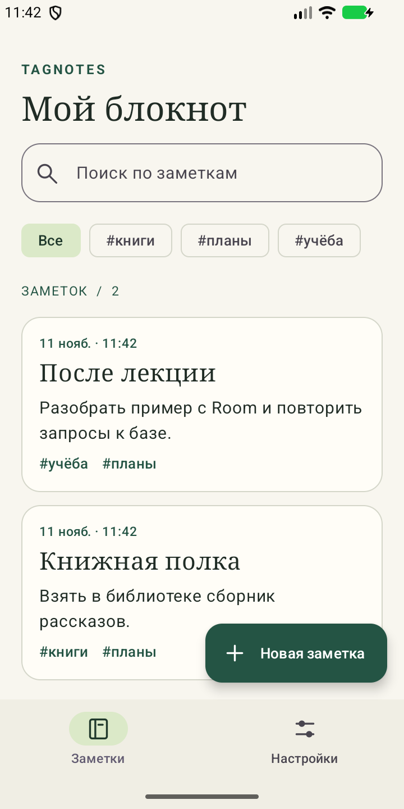
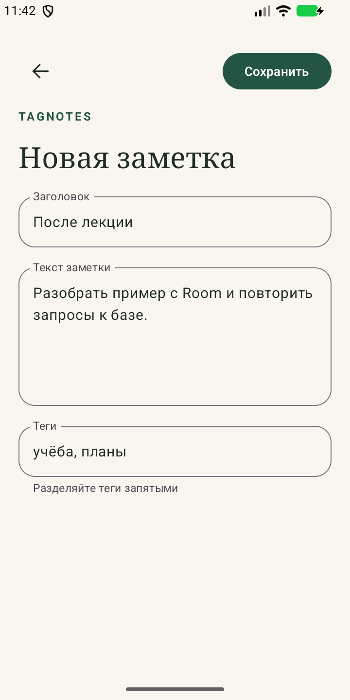
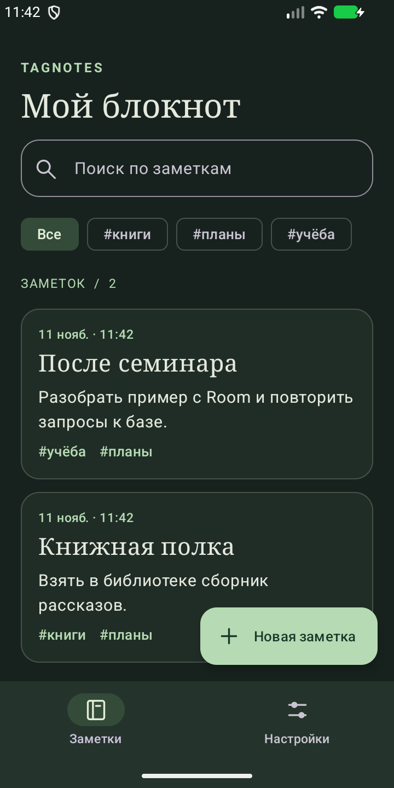

# Tagnotes

Android-приложение для личных заметок с тегами. Ведите блокнот без подключения к сети, ищите слова в записях, выбирайте тему оформления и сохраняйте весь блокнот в Markdown.

## Быстрый старт

Установите приложенный `Tagnotes.apk` на телефон или эмулятор с Android 8.0 (API 26) и новее. Для установки с компьютера используйте `adb install -r Tagnotes.apk`. APK подписан отладочным ключом и предназначен для учебной демонстрации.

1. Нажмите **Новая заметка**. Введите заголовок или текст. В поле тегов укажите, например, `учёба, планы`.
2. Сохраните запись. Выберите тег над списком и введите часть заголовка, текста или метки в строку поиска. Условия работают одновременно.
3. Нажмите на карточку для редактирования или удаления. Перед удалением появляется диалог подтверждения.
4. Откройте **Настройки** и выберите системную, светлую или тёмную тему.
5. Нажмите **Сохранить в файл** и выберите папку. Файл `Tagnotes.md` содержит все записи и их теги в UTF-8, независимо от текущего фильтра.

## Экраны

| Блокнот | Редактор | Тёмная тема |
| --- | --- | --- |
|  |  |  |

## Сборка из исходного кода

Откройте каталог с `settings.gradle` в Android Studio. Для сборки нужны JDK 17 или совместимая более новая версия (проверено с JBR Android Studio), Android SDK Platform 37.0 и Build Tools 36.0.0. Укажите SDK в Android Studio, переменной `ANDROID_HOME` или файле `local.properties`. При первой сборке потребуется подключение к сети.

```powershell
.\gradlew.bat :app:assembleDebug :app:testDebugUnitTest
```

Для Linux и macOS используйте `./gradlew :app:assembleDebug :app:testDebugUnitTest`. APK появится в `app/build/outputs/apk/debug/app-debug.apk`. Проект использует Gradle 9.6.0, Android Gradle Plugin 9.4.1, Kotlin/Compose Compiler 2.2.10, Material 3 и Room 2.8.4.

## Как устроен проект

- `MainActivity.kt` и `Glyph.kt` — интерфейс на Jetpack Compose, список, редактор, настройки, системный диалог создания документа.
- `NotebookModel.kt` — состояние интерфейса, чтение и изменение заметок, оформление и экспорт. Операции ввода-вывода выполняются через корутины.
- `NotebookDb.java`, `NoteDao.java`, `NoteRow.java` — схема Room и запросы к SQLite. В записи хранятся идентификатор, заголовок, текст, метки и время изменения.
- `Notebook.kt` — нормализация тегов, отбор заметок, проверка ввода и формирование Markdown.
- `app/src/test` — девять модульных тестов. `app/src/androidTest` — сквозной сценарий на тестовом устройстве.

## Воспроизведение демо на эмуляторе

Сценарий создаёт две учебные записи, редактирует одну из них, переключает тему, проверяет поиск и фильтр, сохраняет файл в системном диалоге и удаляет вторую запись. Используйте отдельный эмулятор с пустым блокнотом и без существующего файла с предложенным именем. Автоматизация понимает русский и английский варианты кнопки сохранения в системном диалоге.

```powershell
.\gradlew.bat :app:installDebug :app:installDebugAndroidTest
adb shell am instrument -w dev.tagnotes.app.test/dev.tagnotes.app.NotebookDemo
```

Кадры сценария сохраняются в каталоге приложения `Android/data/dev.tagnotes.app/files/demo` на тестовом устройстве. Итоговый статус успешного сценария содержит `PASS`.

## Материалы для защиты

- [Разбор ТЗ, пользовательские истории и критерии приёмки](docs/assignment.md)
- [Три редактируемых макета для импорта в Figma](docs/wireframes)
- [План семиминутного выступления и вопросы](docs/defense.md)

Записи находятся в локальной базе приложения. При удалении приложения Android очищает его данные. Экспортированный пользователем файл остаётся в выбранной папке.
## Результаты проверки

Сборка установлена на эмулятор Android 17 (API 37). Все девять юнит-тестов и сквозной UI-сценарий прошли. После принудительного завершения и повторного запуска приложения в списке сохранилась запись «После семинара». Запись «Книжная полка», удалённая после экспорта, отсутствовала. В [экспортированном во время теста файле](docs/example-export.md) остались обе записи с текстом и тегами.